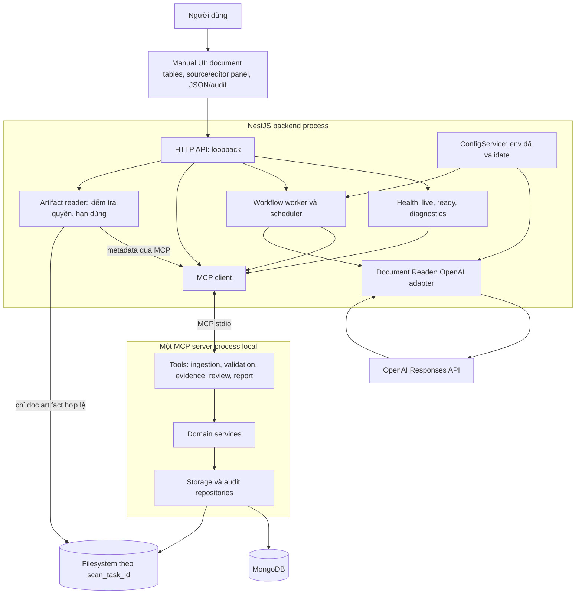
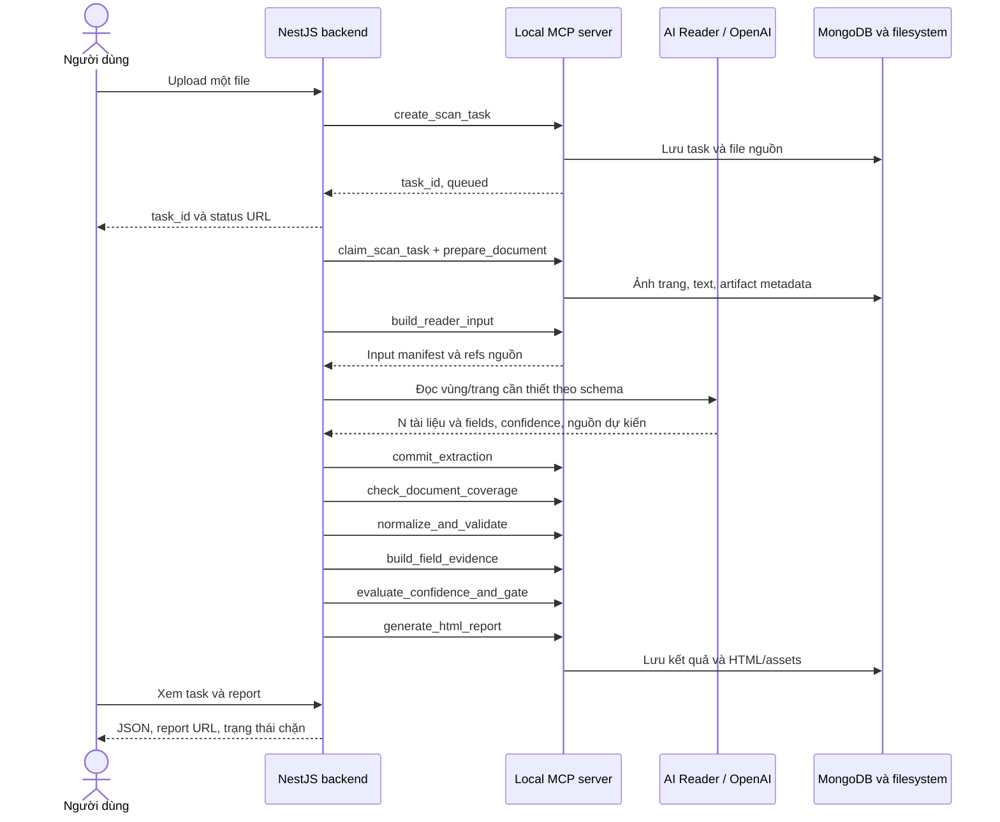
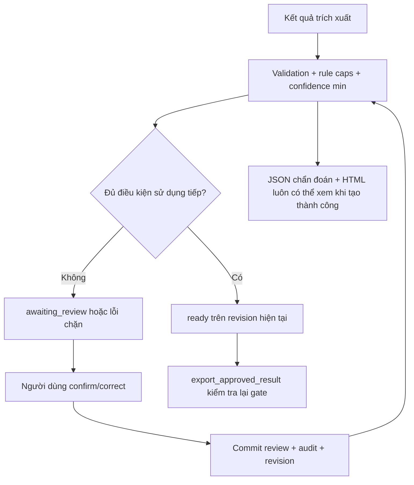
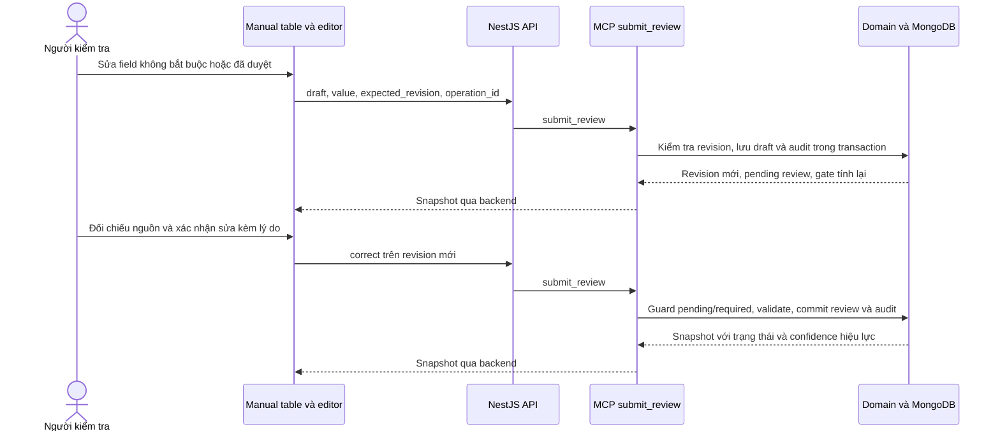
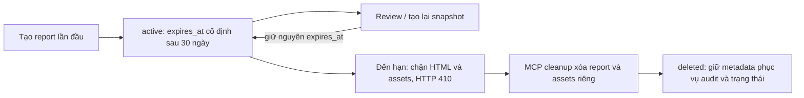

# Architecture — Medical Document Extractor

Cập nhật: 19/10/2026. Trạng thái: kiến trúc bản local đã triển khai và tracking các giới hạn còn mở; trạng thái/bằng chứng cụ thể trong [implementation-status](../plans/implementation-status.md). Không suy ra mọi phương án đã được nghiệm thu hoặc AI đã benchmark.

## 1. Nguồn chuẩn và trạng thái lựa chọn

Hướng dẫn giới thiệu, deploy và chạy test/manual: [readme.md](../readme.md). Port mặc định là `4000`; cấu hình và thao tác vận hành lấy README làm nguồn chuẩn.

- [Project context](../context/project-context.md): yêu cầu gốc và quy tắc nghiệp vụ đã thống nhất.
- [Brainstorm](../context/brainstorm.md): phân tích, rủi ro, phương án và câu hỏi còn mở.
- [First implementation plan](../plans/first-implement-plan.md): các giai đoạn, kiểm thử và nghiệm thu.
- [Test strategy và testcase matrix](../plans/test-strategy.md): smoke, integration deterministic/live, fixtures, expected results và mapping risk/ARCH decisions.
- [Manual review table](../plans/manual-review-table-plan.md): thiết kế đã duyệt, quy tắc thao tác và capture UI thật.
- [Output contract](../context/output-contract.md): confidence, metadata review và định dạng JSON.
- Tài liệu này theo dõi component, luồng dữ liệu, MCP contracts và quyết định kiến trúc. Khi thay đổi kiến trúc, cập nhật decision log và plan; không âm thầm thay quy tắc nghiệp vụ.

Đã chốt: Node.js/TypeScript, NestJS, MongoDB; AI phục vụ đọc tài liệu; công việc xác định được bằng code xây thành MCP tools để giảm sử dụng AI. Bản local dùng OpenAI SDK, MCP stdio, Mongoose/transaction, PDF.js + canvas và sharp. Model do `OPENAI_MODEL` quyết định, không có fallback tự chọn; workspace hiện cấu hình `gpt-6-luna`, chưa benchmark chất lượng trên bộ 10 tài liệu thật qua API.

## 2. Component và ranh giới trách nhiệm



| Thành phần | Trách nhiệm | Giới hạn |
|---|---|---|
| Manual UI | HTML + JS/CSS cùng origin; table, ảnh nguồn/editor, JSON và audit theo snapshot | Không tự tính confidence/gate; chỉ hiện xác nhận khi backend yêu cầu |
| NestJS API | Upload, trạng thái, review, report và export | Không có đường ghi nghiệp vụ bỏ qua MCP/gate |
| Workflow worker | Thứ tự bước cố định, retry hữu hạn, lease, recovery | Không dùng AI để quyết định gọi tool nào |
| Scheduler | Dọn report hết hạn qua MCP | Không tự xóa file gốc/bằng chứng chính |
| MCP client | Initialize/list/call, validate response, timeout và reconnect | Không đưa tools vào prompt model |
| ConfigService | Parse env, cấu hình Reader và dependency, redaction | Thay env + restart; không phát tán key sang MCP |
| HealthModule | Live/ready/capability, trạng thái verify gần nhất | Polling không gọi OpenAI; verify là thao tác chủ động |
| MCP server | Tools chạy code, domain logic và persistence | Không gọi AI ngầm trong tool xử lý thông thường |
| AI Reader | Đọc đa ngôn ngữ, đề xuất ranh giới/loại, fields và nguồn | Không approve, export, xóa hoặc tự điều phối workflow |
| Artifact reader | Phục vụ file/ảnh local theo metadata đã kiểm tra | Không nhận đường dẫn filesystem tùy ý từ người dùng |

MCP server có thể dùng Nest application context để quản lý DI và Mongoose, không mở thêm HTTP endpoint. Backend quản lý lifecycle MCP process; stdout chỉ dành cho protocol, log qua stderr. Không cần expose MCP public hoặc tạo kết nối MCP trực tiếp từ OpenAI trong bản đầu.

## 3. Luồng scan và sử dụng AI



- File nhỏ: mục tiêu một lượt đọc trả cả phân tách, phân loại và fields của N documents nếu nằm trong giới hạn input/output và chất lượng đạt yêu cầu.
- File lớn: chunk có ngữ cảnh liên kết, nhiều lượt có budget hữu hạn. Có thể tách phân tách và extraction nếu benchmark cho thấy cần thiết.
- Không cam kết mọi file chỉ một lần gọi. Confidence thấp mặc định chuyển người kiểm tra, không gọi AI lặp đến khi có điểm cao.
- Retry kỹ thuật có giới hạn; đọc lại vùng theo yêu cầu/chính sách rõ ràng. Mọi lần gọi ghi usage, phiên bản, thời gian, lỗi và chi phí khi tính được.
- Cache chỉ tái dùng khi hash nội dung, input settings, model, prompt và schema tương thích, trong phạm vi dữ liệu được phép truy cập. Cache không mang theo approve; mỗi upload vẫn có task mới.
- Text/tọa độ có sẵn trong PDF lấy bằng code. Không mặc định bỏ ảnh vì PDF có text; lớp text hoặc thứ tự đọc có thể sai.
- Hiểu ranh giới tài liệu/bệnh nhân là đề xuất AI, không được coi là code có thể tự chứng minh hoàn toàn. MCP kiểm tra cấu trúc/coverage, yêu cầu review khi không chắc.
- Các tác vụ tính tổng, validation, confidence aggregation, crop, report, review và cleanup không gọi AI.

## 4. MCP tool catalog

Các tools dùng contracts chung, input/output có schema và lỗi có mã. Thay đổi trạng thái nhận `expected_revision` và `operation_id` khi phù hợp. Retry cùng operation không tạo bản ghi/hiệu ứng trùng. Actor/role do backend tin cậy cung cấp trong ngữ cảnh, không tin tên reviewer trong payload người dùng.

| Tool | Trách nhiệm và đầu ra |
|---|---|
| `get_system_health` | Health local MongoDB/storage, tool version và checked_at; không AI, không secret |
| `create_scan_task` | Tạo task và liên kết file đã upload trong staging được quản lý; trả ID/status |
| `claim_scan_task` | Claim công việc atomic, lease token, heartbeat/release để phục hồi worker |
| `advance_scan_task` | Checkpoint bước theo expected revision và lease hợp lệ; không được tự đặt ready bỏ qua gate |
| `prepare_document` | Kiểm tra file, render trang, text/tọa độ, page manifest |
| `build_reader_input` | Input manifest, trang/vùng và schema refs cho Reader; không gọi AI |
| `commit_extraction` | Validate, lưu output AI và phiên bản dưới revision mới |
| `check_document_coverage` | Tìm vùng/trang thiếu, trùng, chưa phân loại và liên kết nghi vấn |
| `normalize_and_validate` | Quy tắc ngày, tiền, flag, thiếu dữ liệu; warnings/errors theo field path |
| `build_field_evidence` | Crop theo tọa độ đã kiểm tra, page fallback, artifact metadata |
| `evaluate_confidence_and_gate` | Min confidence, rule caps, pending review và blocking errors |
| `get_review_queue` | Những trường/tài liệu cần kiểm tra cùng source refs |
| `submit_review` | Draft/approve/correct hoặc confirm_structure theo policy; transaction audit/revision, idempotency và tính lại validation/gate |
| `generate_html_report` | Tạo snapshot revision hiện tại, assets offline, giữ expires_at ban đầu |
| `generate_test_report` | Hợp nhất normalized results theo test_run_id, sinh một trang HTML cho smoke/integration/OpenAI live; 10 baseline documents có kết quả riêng, không gọi AI |
| `get_report_link` | URL thực tế, expiry, revision; không phục vụ báo cáo hết hạn |
| `get_artifact_metadata` | Kiểm tra task/actor/expiry để backend đọc đúng file hợp lệ |
| `cleanup_expired_reports` | Chỉ dọn report/assets riêng theo manifest; retry an toàn |
| `get_scan_task` | JSON chẩn đoán và trạng thái, kể cả khi đang bị chặn |
| `export_approved_result` | Chỉ xuất revision đã commit, gate đạt; không được bypass bằng gọi trực tiếp |

Tools trả artifact IDs/metadata, không đẩy toàn bộ ảnh base64 qua mọi tool. Backend có quyền đọc nguồn hợp lệ để gửi AI hoặc phục vụ người dùng. Tool handler không tự ý gọi OpenAI để “sửa” dữ liệu.

## 5. Mô hình lưu trữ MongoDB và filesystem

### Collections dự kiến

| Collection | Nội dung chính |
|---|---|
| `scan_tasks` | File hash, processing status, lease/checkpoint, current revision, confidence/gate, budget summary |
| `document_results` | Một tài liệu/revision: loại, source refs, fields và confidence; danh sách lớn có thể chia chunk |
| `extraction_runs` | Model/prompt/schema/input version, output nguồn, usage, lỗi, retry và cache provenance |
| `artifacts` | Task/document/field refs, loại file, đường dẫn nội bộ, trang/bbox, hash và trạng thái |
| `review_events` | Audit append-only: actor, thời điểm, trước/sau, lý do và revision |
| `reports` | Loại scan/test_run, owner ID, snapshot revision, created_at, expires_at, manifest, lifecycle và cleanup status |
| `test_runs` / `test_case_results` | Run/build/env đã redact, expected testcase manifest, suite/case/subcase/attempt, status, diff/evidence và usage; dữ liệu test tách môi trường thật |
| `operations` | Idempotency keys, kết quả thao tác và thông tin recovery |

- Không nhúng toàn bộ một task nhiều trang/fields/ảnh trong một MongoDB document không giới hạn. Ảnh và PDF lưu filesystem; MongoDB lưu refs.
- Index dự kiến: task/status/lease, task+document+revision, task+artifact, report expiry/cleanup status, operation key unique, audit theo task/revision/time.
- Tính tiền bằng decimal.js từ chuỗi, lưu Decimal128; JSON trả chuỗi thập phân. Không chuyển qua JavaScript Number. Nếu vượt độ biểu diễn thì báo/chặn, không âm thầm làm tròn.
- Review, audit và current revision pointer commit trong transaction; dùng revision compare-and-swap để chống cập nhật đồng thời. Phương án local: MongoDB single-node replica set; kiểm chứng trong spike, hướng dẫn trong README.
- Kết quả/chunk revision đang tạo không được export; current pointer chỉ chuyển khi đã commit đủ và gate tính trên đúng revision.
- MongoDB và filesystem không có transaction chung: ghi file tạm, kiểm tra manifest/hash rồi publish, cập nhật trạng thái; có bước reconciliation khi crash. Không đánh dấu complete khi artifacts còn thiếu.

```text
runtime/tasks/<scan_task_id>/
  source/                      # file gốc
  pages/                       # ảnh trang và metadata phép biến đổi
  evidence/<revision>/         # ảnh bằng chứng chính
  reports/                     # index.html, assets riêng, manifest
  staging/                     # tệp đang tạo, chưa công bố
```

Report assets phải là bản riêng, không tham chiếu trực tiếp sang thư mục evidence chính, để HTML mở offline và cleanup không phá review. Nội dung HTML escape, đường dẫn tương đối được kiểm soát.

## 6. Review và export gate



- Confidence tổng lấy min, gồm segmentation/classification/coverage và fields/list items. Bất kỳ thành phần `<0.5` thì task `<0.5`.
- Ngày, cờ xét nghiệm, tiền khác format quy ước và các trường hợp đã chốt trong context phải review độc lập confidence.
- Giữ extraction confidence ban đầu; điểm hiệu lực sau review riêng. Quy ước 1.0 sau xác nhận không phải xác suất AI đúng.
- Gate chỉ đạt khi mọi yêu cầu review đã hoàn tất, không còn confidence hiệu lực `<0.5`, không còn blocking error hoặc nguồn chưa được xử lý.
- Rerun/sửa nguồn tạo revision, vô hiệu hóa xác nhận liên quan. Export đối chiếu current revision đã commit; nếu lệch trả conflict thay vì dùng quyết định cũ.

### Trang manual test tương tác

Đã triển khai `/manual-test` tại port mặc định `4000`. NestJS phục vụ `public/manual.html`, `/manual-test.js` và `/manual-test.css` cùng origin; không dùng framework UI hoặc Handlebars cho trang manual. Upload tạo task; polling và đổi fragment `#task=<id>` tải snapshot từ backend.

Mỗi document có table riêng: field/path, giá trị hiện tại, điểm AI, điểm sau kiểm tra, trạng thái và thao tác. Panel đối chiếu crop/ảnh trang với raw/candidate/normalized/current value, đồng thời chứa form sửa. JSON đầy đủ và audit nằm dưới table; audit được đối chiếu đúng task/revision. Table cuộn ngang trên màn hình nhỏ, panel chuyển xuống dưới; màu confidence luôn đi cùng số/chữ.

#### Contract và quyền quyết định

- Backend suy ra `review_reasons` cho field và `requires_structure_review` cho document; đây là metadata bổ sung tương thích. Ngày rõ có `DATE_REVIEW_REQUIRED` dù confidence cao, không tạo warning lỗi giả. Blocking validation theo path cũng đưa field vào diện cần xử lý.
- `requires_review` phải xét cùng `review_status`: `pending` chỉ nói chưa được người duyệt, không có nghĩa mọi field đều bắt buộc. Field không bắt buộc không có nút Xác nhận; vẫn có Sửa. Field đã confirmed/corrected không có xác nhận lặp.
- Document chỉ hiện xác nhận cấu trúc khi chưa xác nhận và classification hoặc segmentation `<0.5`. Coverage/validation là điều kiện riêng; xác nhận field hoặc cấu trúc không tự giải quyết nguồn còn thiếu.
- `final_confidence` là alias API của effective confidence, không lưu hai bản final/effective độc lập. Pending dùng điểm sau caps; confirmed/corrected hợp lệ dùng 1.0 theo quy ước người xác nhận. UI hiển thị “Sau kiểm tra: —” khi chưa qua người, giữ nguyên số trong JSON. Điểm 1.0 không phải xác suất đúng 100%.
- Raw và confidence trích xuất được giữ nguyên sau review; UI ghi rõ điểm AI đang hiển thị là `extraction_confidence` sau policy. Task có thể ready với confidence 0.99; không yêu cầu xác nhận thêm chỉ để đạt 1.0.
- Export chỉ bật theo `status=ready` của backend. `export_approved_result` kiểm tra gate/revision lại, không tin số hàng/nút trên UI. Không có input cho client tự đặt confidence.

#### Luồng review và chống cập nhật chồng



Field không bắt buộc hoặc đã duyệt đi qua **Sửa → Lưu nháp → Xác nhận sửa**. Draft mở vòng review mới, final confidence bị cap `<0.5`, task được tính lại và không kế thừa xác nhận cũ. Field bắt buộc pending có thể approve giá trị hợp lệ hoặc correct trực tiếp kèm lý do. Giá trị null thật sự thiếu cần lý do xác nhận thiếu; giá trị nhìn thấy nhưng chưa đọc chắc phải được giải quyết theo validation.

`submit_review` kiểm tra idempotency cùng operation ID trước guard để retry không tạo tác dụng trùng. API từ chối approve/correct ngoài vòng review hợp lệ (`REVIEW_NOT_REQUIRED`, HTTP 409), approve field có blocking validation (`FIELD_VALIDATION_REQUIRED`, HTTP 409) và xác nhận cấu trúc không cần thiết (`STRUCTURE_REVIEW_NOT_REQUIRED`, HTTP 409). Correction cần lý do; mọi thao tác vẫn chịu kiểm tra task status, expected revision và validation. Lỗi tổng tiền không được xóa chỉ vì đã xác nhận.

Review, audit, operation và revision pointer commit trong một MongoDB transaction; sau đó report được cập nhật như projection có thể phục hồi. Lỗi tạo report không rollback review đã commit. Khi HTTP 409 do revision conflict, UI giữ giá trị/lý do người dùng đang nhập, tải snapshot mới và yêu cầu đối chiếu rõ ràng trước khi gửi lại với revision mới. Khi đang gửi thì khóa thao tác ghi để tránh double submit.

Snapshot đọc cũng chạy evaluate để task cũ nhận metadata/policy mới mà không cần ghi migration; chỉ cập nhật cách chiếu gate với task ready/awaiting_review, giữ trạng thái queued/processing/failed. Manual page/polling/review không gọi AI. Report HTML offline là snapshot để xem, không có chức năng approve; manual page cần backend. Test report giữ verdict trước/sau review riêng.

## 7. Report 30 ngày và trạng thái task

Task hiện tại: `queued → processing → awaiting_review/ready`, hoặc `failed`; sau review có thể chuyển lại `awaiting_review` nếu vẫn còn vấn đề. Report có lifecycle riêng, không làm task failed khi hết hạn.



- Nest scheduler gọi cleanup khi startup và định kỳ; artifact serving kiểm tra expiry ở mọi request, kể cả ảnh.
- MongoDB TTL index không xóa file filesystem. Không xóa report metadata trước khi hoàn thành cleanup; giữ thông tin để retry/trả thông báo hết hạn.
- Bản đầu không dùng TTL thay cleanup; TTL chỉ có thể bổ sung cho dữ liệu tạm độc lập sau khi xác định vòng đời.
- Máy/ứng dụng tắt: xóa vật lý khi chạy lại. Muốn đúng hạn khi đóng ứng dụng cần tác vụ hệ điều hành riêng.
- File gốc/evidence chính có retention riêng chưa chốt. Bản người dùng copy ra ngoài vùng quản lý không thu hồi được.

### Trang report test tổng hợp

Một test_run có một trang HTML chung cho smoke, integration deterministic và OpenAI thật; thêm nhóm UI e2e khi có. Report live luôn có 10 baseline documents theo cơ cấu 3/3/2/2; preflight/composite/holdout riêng, không tính thay baseline. Mỗi document có expected/actual diff, evidence, confidence/gate và usage thực.

Runner xuất normalized JSON → aggregator → MCP `generate_test_report` → HTML/assets/manifest theo test_run_id → test_report_url. Không dùng AI sinh report; suite chưa chạy/thiếu key/crash hiển thị đúng NOT_RUN/SKIPPED/partial. Không tổng hợp dữ liệu từ các runs khác nhau hoặc giấu attempt lỗi.

Tái dùng report retention 30 ngày theo loại owner/manifest, tách test assets khỏi scan sources và fixtures. Chi tiết acceptance và IT-TREPORT-01–05 trong mục 14 của [test strategy](../plans/test-strategy.md).

## 8. Bảo mật và khả năng phục hồi

- HTTP loopback; MCP stdio giữa process local; MongoDB credentials và OpenAI key ngoài repo/report/log.
- Model nhận tài liệu như dữ liệu, không có công cụ approve/export/delete. Phân tách người review và AI bằng quyền backend, không dựa vào prompt.
- Chặn path traversal, truy cập chéo task và HTML injection; xác minh artifact ownership/expiry trước phục vụ file.
- Task queue lưu bền trong MongoDB; atomic claim + lease + heartbeat + checkpoint. Worker cũ mất lease không được ghi kết quả; operation ID xử lý retry an toàn.
- Xử lý riêng MCP disconnect, API refusal/incomplete, file lỗi và failed report. Task không được marked ready chỉ vì request AI trả HTTP thành công.
- Xử lý crash giữa file write/DB update bằng reconciliation. Không tự xóa artifacts chính như một phần cleanup report.
- Không đưa hồ sơ y tế thật lên GitHub; thử nghiệm bằng dữ liệu giả lập/ẩn danh. Chính sách API data retention cần kiểm tra trước dùng dữ liệu thật.

### Cấu hình OpenAI và healthcheck

Yêu cầu mới đã chốt: tích hợp OpenAI bằng env, không sửa source khi đổi key/model trong phạm vi adapter hỗ trợ; bổ sung healthcheck. Contract đầy đủ, default/required, lỗi và tiêu chí nghiệm thu nằm ở mục 2.1–2.2 của [plan](../plans/first-implement-plan.md).

- ConfigModule/Zod validate tại startup, map rõ env → OpenAI client/request; `.env.example` không chứa secret. Backend chỉ cấp env allowlist cho MCP child.
- `OPENAI_API_KEY`, `OPENAI_MODEL`, `OPENAI_BASE_URL`, project/org tùy chọn, timeout/retry và budget AI cấu hình qua env. Base URL thay đổi không bảo đảm tương thích mọi provider; model cần hỗ trợ vision/schema và account có quyền.
- Thay env + restart; không cần rebuild chỉ để đổi key/model. Không hot reload; graceful shutdown và recovery task dở. Reset verification status theo cấu hình mới.
- `GET /health/live`: process liveness, không phụ thuộc external services. `GET /health/ready`: dependency local/cấu hình sẵn sàng scan; trả 503 khi thiếu, không cam kết provider remote online.
- `GET /health`: capability scan/review/report, dependency timestamps, `configuration_valid`, `verification_status`, `last_verified_at`, last error đã redact. Không hiển thị key/URI hoặc dữ liệu y tế.
- MCP `get_system_health` thực hiện local probes; HealthModule backend dùng timeout/cache hữu hạn. Worker heartbeat và MCP catalog/handshake do backend kiểm tra.
- `POST /diagnostics/openai/verify`: thao tác người dùng chủ động, có quyền và cooldown, request ảnh giả lập/schema tối thiểu, có token cost; không chạy từ polling/startup, không chứng minh chất lượng đọc tài liệu thực tế.
- OpenAI chưa verify trả `not_checked`, không giả lập trạng thái kết nối thành công. Quota/auth/model/network lỗi được phân biệt, không fallback mock âm thầm. Thiếu AI không khóa review/report đã có nếu dependency liên quan vẫn tốt.

Nguồn tham khảo cho implementation: [OpenAI quickstart](https://developers.openai.com/api/docs/quickstart), [Nest configuration](https://docs.nestjs.com/techniques/configuration), [Nest health checks](https://docs.nestjs.com/reliability/terminus). Phiên bản thư viện kiểm tra lại khi dựng code; các env budget/health là contract ứng dụng.

## 9. Tracking quyết định và kiểm chứng

| ID | Quyết định/phương án | Trạng thái | Bằng chứng nghiệm thu / bước tiếp |
|---|---|---|---|
| ARCH-001 | Node.js/TypeScript, NestJS | Người dùng đã chốt | Workspace và API smoke test |
| ARCH-002 | MongoDB | Người dùng đã chốt | Schema/index và integration tests |
| ARCH-003 | AI đọc tài liệu; code qua MCP cho tác vụ xác định được | Yêu cầu đã chốt | Non-reader tools không phát sinh AI calls |
| ARCH-004 | Backend workflow cố định, một MCP server stdio | Phương án hiện tại | Initialize/list/call, reconnect, idempotency |
| ARCH-005 | OpenAI Reader + structured output, model cấu hình | Phương án; model chưa chốt | Benchmark độ chính xác/chi phí |
| ARCH-006 | Mongoose, replica set local, transaction và revision | Đã triển khai local | Integration concurrent review/audit và browser conflict PASS |
| ARCH-007 | decimal.js + Decimal128 + JSON string | Phương án hiện tại | Money round-trip và validation precision |
| ARCH-008 | PDF.js + canvas Node, sharp crop | Đã triển khai; canvas pin 1.0.11 | Render/crop integration và Linux container PASS; benchmark AI đa ngôn ngữ còn mở |
| ARCH-009 | HTML offline, report/assets riêng, retention 30 ngày qua cleanup | Đã triển khai local | Expiry/cleanup integration; không dùng MongoDB TTL để xóa file |
| ARCH-010 | Cache, worker lease, chunking hữu hạn | Phương án cần kiểm thử | Không reuse approve, không trùng/thiếu tài liệu |
| ARCH-011 | OpenAI qua env; đổi cấu hình + restart, không sửa code | Đã triển khai | Env validation/client mapping và secret redaction; live suite do người dùng chạy sau |
| ARCH-012 | Healthcheck live/ready/capability và verify OpenAI chủ động | Người dùng yêu cầu healthcheck; chi tiết là thiết kế hiện tại | Dependency failure/recovery, polling 0 AI calls, verify không dùng hồ sơ thật |
| ARCH-013 | Review policy ở backend, table chỉ xác nhận field required/pending; optional edit qua draft | Đã triển khai và nghiệm thu local/Docker | [Plan và evidence](../plans/manual-review-table-plan.md#7-kết-quả-triển-khai-và-nghiệm-thu), integration guard và browser flows PASS |
| ARCH-014 | HTML/JS/CSS local, snapshot JSON/audit, giữ draft khi revision conflict | Đã triển khai | Browser desktop/mobile, reload/hashchange, conflict/rebase và injection-as-text PASS |

Coverage tối thiểu cho ARCH-001–012 được theo dõi tại mục 13 của [test-strategy](../plans/test-strategy.md), kèm các quy tắc nghiệp vụ trong context. Smoke/integration có testcase và trạng thái riêng; mock PASS không chứng minh model đọc đúng tài liệu.

Bằng chứng mới nhất cho manual review table: **37 unit, 12 smoke và 73 integration PASS**; kiểm tra browser và runtime/test images Linux PASS. Browser cases tái dùng ID trong catalog, không cộng thành 87 test độc lập. [Report host](http://127.0.0.1:4000/test-reports/table-review-implementation-20261019/index.html), [report Docker offline](../outputs/manual-review-table-acceptance/docker-test-report/index.html), [deployment checks](../outputs/manual-review-table-acceptance/deployment-validation.json). Thay đổi UI/review này không gọi OpenAI thật.

Các lựa chọn kiến trúc giữ trạng thái nguồn quyết định/phương án trong bảng; mức triển khai và bằng chứng thực tế đã cập nhật ở [implementation-status](../plans/implementation-status.md). Bản local đã chạy smoke/integration/Chromium và container validation; OpenAI live chưa chạy. Không suy ra production readiness hoặc mọi tổ hợp đã kiểm chứng.

## 10. Câu hỏi còn mở

- Benchmark/chốt model và tập ngôn ngữ theo chất lượng/chi phí; chạy live suite 10 tài liệu. SDK và giới hạn local đã có cấu hình/code; mức phù hợp production cần đánh giá riêng.
- Ngưỡng tiền tuyệt đối/làm tròn, trường bắt buộc downstream, danh tính/xác thực reviewer.
- Retention của file gốc và evidence chính; yêu cầu xóa đúng hạn khi ứng dụng đóng.
- Các câu hỏi được quản lý cùng [brainstorm](../context/brainstorm.md), công việc tương ứng trong mục 11 của [plan](../plans/first-implement-plan.md).

## 11. Lịch sử cập nhật

| Ngày | Thay đổi |
|---|---|
| 19/10/2026 | Tạo architecture tracking; ghi lựa chọn Node.js/NestJS/MongoDB, ranh giới AI/MCP, tool catalog, lưu trữ, review và report retention; đồng bộ plan/context/brainstorm |
| 19/10/2026 | Bổ sung env-driven OpenAI, cấu hình qua restart, MCP health tool, live/ready/capability và diagnostics verify chủ động; đồng bộ plan |
| 19/10/2026 | Bổ sung test-strategy: ma trận smoke/integration theo rủi ro và decision, fixture đa dạng, expected result, suite live riêng và tiêu chí nghiệm thu |
| 19/10/2026 | Bổ sung một trang HTML tổng hợp test; chuyển live suite sang 10 baseline documents độc lập, giữ các chiều stress/composite/holdout và theo dõi usage/partial runs |
| 19/10/2026 | Bổ sung trang manual test: upload, xem N results/ảnh nguồn, approve/correct, final_value/final_confidence và trạng thái do backend tính; kiểm thử browser và audit/conflict |
| 19/10/2026 | Tạo readme hướng dẫn bài toán/giải pháp/giới hạn, deploy local, các test suites và report/manual; đồng bộ quy ước scripts và TEST_RUN_ID, chưa xác nhận chạy thực tế |
| 19/10/2026 | Thực thi bản local NestJS/MCP/MongoDB, manual/reports/test runners; theo dõi kết quả thật và giới hạn tại implementation-status; người dùng hoãn live OpenAI |
| 19/10/2026 | Nghiệm thu local: 25 unit, 12 smoke và 73 integration PASS; Chromium manual flow PASS; 10 OpenAI live SKIPPED theo người dùng; Docker build/Linux scan PASS |

| 19/10/2026 | Triển khai manual review table: backend review reasons/structure flag, guard approve/correct, optional draft và conflict/rebase; cập nhật nguồn UI, confidence presentation và bằng chứng 37 unit + 12 smoke + 73 integration/browser/Docker |

## Vận hành bằng Docker Compose

`docker compose up -d --build --wait` chạy backend (tự khởi động MCP) và MongoDB replica set. `APP_PORT` trong `.env` dùng cho cả host publish/container port; `APP_URL` tự suy ra theo port nếu không khai báo. Backend và service test chạy user `node`, dùng chung volume `app-data` để backend phục vụ report test; MongoDB dùng `mongo-data`. Profile `test` có image chứa dev dependencies và bộ PDF scan, chạy smoke/integration với DB test riêng, không gọi OpenAI thật. Runtime image chỉ giữ dependencies production. Healthcheck container kiểm tra khả năng review/MCP/storage/database kể cả mock mode; không gọi provider. Hướng dẫn vận hành chính nằm trong [README](../readme.md).
