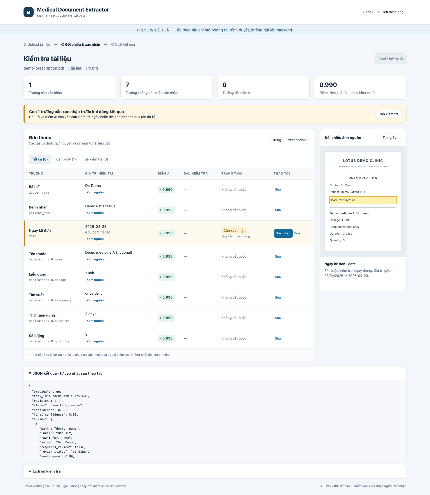

# Manual review table — investigation và implementation plan

Ngày: 19/10/2026. Trạng thái: **đã được người dùng duyệt và triển khai trên ứng dụng local port 4000**. Prototype giữ lại để đối chiếu thiết kế; capture giao diện thực tế và bằng chứng nghiệm thu ở mục 7.

## 1. Mục tiêu đã thống nhất

- Chuyển kết quả theo từng field từ các khối dài sang **table**, nhóm theo document.
- **Chỉ field cần xác nhận mới có chức năng xác nhận.** Field đọc rõ, không vi phạm quy tắc không phải được approve thêm chỉ để điểm tăng lên 1.
- Phân biệt điểm trích xuất AI, trạng thái review và điểm sau khi người kiểm tra xác nhận.
- Giữ khả năng sửa giá trị, ảnh nguồn, JSON, audit/revision và export gate đã có.

## 2. Kết quả investigation

### Nguyên nhân gây hiểu nhầm hiện tại

| Quan sát | Nguyên nhân trong code | Hệ quả |
|---|---|---|
| `doctor_name` không cần review nhưng vẫn có Approve | `render()` tạo Approve/Save draft/Confirm correction cho mọi field | Người dùng tưởng mọi field đều phải xác nhận |
| Field hiện `pending` dù không chặn task | `review_status=pending` là trạng thái mặc định, còn gate xét thêm `requires_review` | UI đồng nhất “chưa qua người” với “bắt buộc kiểm tra” |
| AI 0.990 và Final 0.990 xuất hiện song song | Khi pending, domain cho final confidence kế thừa extraction confidence | Nhãn Final dễ bị hiểu là đã được duyệt |
| Document luôn có nút xác nhận nguồn/loại | UI không kiểm tra có cần structural review hay không trước khi hiện nút | Tăng thao tác không cần thiết để cố đạt điểm 1 |
| Chỉ ẩn nút ở UI chưa đủ | API review hiện vẫn nhận approve trên field không bắt buộc | Hành vi UI/API không được ràng buộc thống nhất |

Task được dùng để đối chiếu logic: `b601e59a-3f3d-44e0-add0-45591d53effb`. Khi kiểm tra: 8 field pending; chỉ `date` có `requires_review=true`, `doctor_name` là false. Không đưa nội dung cá nhân trong task vào prototype hoặc ảnh capture.

### Điểm cần xử lý thêm khi chuyển sang table

- Ngày rõ vẫn bắt buộc review nhưng có thể không có warning; không được suy ra cần review chỉ từ điểm thấp hoặc danh sách warnings.
- `TOTAL_MISMATCH` là blocking validation error nhưng không nhất thiết đã phản ánh vào `requires_review` của field. Phải giữ nguyên việc chặn export, đồng thời đưa người dùng đến nơi cần xử lý.
- Classification/segmentation và coverage thuộc document/task, không thể giải quyết mọi lỗi bằng nút xác nhận field.
- Field không bắt buộc vẫn có thể bị người dùng phát hiện sai. Không được bỏ khả năng chỉnh sửa; cần tách chỉnh sửa chủ động khỏi approve không cần thiết.

Nguồn đối chiếu: [manual page](../public/manual.html), [evaluate/gate](../packages/domain/index.ts), [review service](../packages/storage/service.ts), [field contract](../packages/contracts/index.ts), [test runner](../tests/run.ts).

## 3. Thiết kế đã duyệt và triển khai

### Bố cục

1. Giữ upload, chế độ hoạt động và hướng dẫn `mock-samples/`/`manual-test-samples/`.
2. Tổng quan: tên file, số tài liệu/trang, số field cần xử lý, không bắt buộc và đã được người kiểm tra duyệt. Đưa lý do task chưa ready ra banner.
3. Mỗi document có một table; list item dùng nhãn dễ đọc kèm path như `medications.0.name` để đối chiếu JSON.
4. Bên cạnh là ảnh nguồn/crop và vùng sửa field đang chọn. Không tải mọi crop lớn vào từng hàng.
5. JSON đầy đủ bên dưới, mặc định mở, có vùng cuộn và có thể thu gọn; audit có thể thu gọn. Cả hai cập nhật theo snapshot API mới nhất.
6. Export chỉ bật khi **backend trả `status=ready`**, không suy ra ready từ số nút còn lại.

### Cột table

| Cột | Nội dung |
|---|---|
| Trường | Nhãn dễ đọc + field path gốc |
| Giá trị hiện tại | Giá trị final/draft hiện hành, raw khi khác, trạng thái null rõ ràng; mở chi tiết để xem candidate/normalized |
| Điểm AI | `extraction_confidence` sau quy tắc, màu kèm số; không phải xác suất đã hiệu chuẩn |
| Sau kiểm tra | `—` nếu chưa được người xác nhận; điểm final nếu confirmed/corrected |
| Trạng thái | Không bắt buộc / Cần xác nhận / Đã xác nhận / Đã điều chỉnh, kèm lý do cần review |
| Thao tác | Xem/sửa theo trạng thái; chỉ hiện Xác nhận khi đủ điều kiện |

“—” là cách trình bày **chưa có review của người**, không thay `final_confidence` thành null trong JSON. API và cách tính confidence hiện hành được giữ tương thích. Điểm 1.000 sau review biểu thị đã xác nhận, không có nghĩa AI đúng 100%.

### Quy tắc thao tác

| Trạng thái field từ backend | Hiển thị | Xác nhận | Sửa |
|---|---|---|---|
| `requires_review=false`, `pending` | Không bắt buộc; Sau kiểm tra `—` | Không có nút | Có thao tác Sửa thứ cấp |
| `requires_review=true`, `pending` | Cần xác nhận + lý do | Có nếu giá trị hiện tại có thể được xác nhận hợp lệ | Có |
| `confirmed` hoặc `corrected` | Đã xác nhận / Đã điều chỉnh | Không hiện nút xác nhận lặp | Có; sửa lại phải mở vòng review mới |
| Task queued/processing/failed | Thông tin xử lý/lỗi phù hợp | Không cho thao tác review | Không cho lưu review |

Với field không bắt buộc, **Sửa → Lưu nháp → backend đánh dấu cần review → Xác nhận sửa**. Không tự hiện nút xác nhận ngay khi mở form sửa; draft không được kế thừa hiệu lực xác nhận cũ.

Với field bắt buộc, có thể xác nhận giá trị hiện tại hoặc mở sửa. Giá trị mơ hồ/không hợp lệ không được xác nhận cho xong: ngày cần ISO đã giải quyết rõ; giá trị nhìn thấy nhưng chưa đọc chắc phải được xử lý; trường thật sự thiếu có thể xác nhận thiếu kèm lý do theo quy tắc hiện hành. Blocking error vẫn phải được giải quyết bằng validation của backend.

## 4. Prototype và capture đã có

- [x] [Prototype tương tác](previews/manual-review-table/index.html): HTML local, dùng dữ liệu giả, không gọi API hoặc OpenAI.
- [x] [01 — Chờ xác nhận ngày](previews/manual-review-table/01-pending-review.png): doctor_name không có Xác nhận, chỉ date có.
- [x] [02 — Sửa field bắt buộc](previews/manual-review-table/02-edit-required-field.png): đối chiếu nguồn, giá trị, lý do, lưu nháp/xác nhận sửa.
- [x] [03 — Hoàn tất review](previews/manual-review-table/03-review-complete.png): nút xác nhận biến mất, trạng thái được cập nhật.
- [x] [Kiểm tra prototype](previews/manual-review-table/preview-validation.json): kiểm tra điều kiện nút, draft, JSON và không có browser error.

Ảnh nguồn trong prototype là tài liệu minh hoạ dựng bằng HTML, không phải ảnh hồ sơ thật. Export, lưu và xác nhận ở preview chỉ mô phỏng state trong trình duyệt; không đại diện cho triển khai/gate production đã hoàn tất.

## 5. Kế hoạch triển khai cụ thể

### Bước 1 — Chuẩn hóa điều kiện review ở backend

- [x] Dùng `requires_review` từ backend làm nguồn quyết định, kết hợp `review_status=pending` và trạng thái task hợp lệ; frontend không tự sửa điểm hoặc tự đặt task ready.
- [x] Bổ sung `review_reasons` dạng danh sách mã đọc được trên snapshot, được suy ra ở backend từ quy tắc ngày/flag/money/currency, missing/handwriting, confidence và validation errors. Ngày rõ cần lý do review nhưng không phải tự hạ điểm AI hoặc tạo warning lỗi giả.
- [x] Đánh dấu field pending có blocking validation error trỏ tới path là cần xử lý; giữ error tách khỏi “đã xác nhận”. `TOTAL_MISMATCH` không được biến mất chỉ vì approve.
- [x] Tách structural review/coverage thành banner document/task khi thực sự cần; không yêu cầu xác nhận cấu trúc chỉ để nâng 0.99 lên 1.
- [x] API từ chối yêu cầu approve/confirm correction không thuộc vòng review hợp lệ với mã lỗi rõ như `REVIEW_NOT_REQUIRED`; thao tác draft được dùng để bắt đầu chỉnh sửa chủ động. Giữ xử lý idempotency của cùng operation ID trước khi coi request là xác nhận lặp.
- [x] Giữ expected_revision, audit, reason, rule validation và tính confidence tại backend; không thêm API cho client tự nhập confidence.

File: `packages/domain/index.ts`, `packages/contracts/index.ts`, `packages/storage/service.ts`; bổ sung schema MCP nếu contract input thực sự thay đổi. Các field snapshot bổ sung là additive, không xóa raw/value/final hiện có.

### Bước 2 — Refactor UI sang table

- [x] Tạo table semantic theo document, nhãn + path, trạng thái có màu/chữ, ô giá trị hiển thị null rõ ràng; giữ số tiền dạng chuỗi, không dùng Number gây mất precision.
- [x] Chỉ render nút xác nhận khi field cần review và pending. Field không bắt buộc giữ Sửa thứ cấp, không có Approve/Confirm correction trực tiếp.
- [x] Bộ lọc Tất cả / Cần xử lý / Đã kiểm tra và số lượng dựa trên state từ backend, không đồng nhất pending với cần review.
- [x] Mở ảnh nguồn/crop và form field được chọn trong panel; bbox không chắc dùng cả trang, thiếu crop vẫn có đường dẫn nguồn phù hợp.
- [x] Giữ nguyên ngôn ngữ/giá trị nguồn. Nhãn friendly không thay đổi field path/schema.
- [x] Giữ JSON đầy đủ mặc định mở, đồng bộ với giá trị/trạng thái API sau mọi thao tác và đổi task; audit giữ lịch sử.

File chính: `public/manual.html`. Chỉ tách JS/CSS thành file riêng nếu cần để quản lý renderer; không thêm framework UI cho riêng việc đổi layout.

### Bước 3 — Luồng sửa, lỗi và responsive

- [x] Sửa field không bắt buộc phải qua draft được backend lưu, sau đó mới có chức năng xác nhận. Hủy sửa không tạo revision hoặc thay task.
- [x] Xác nhận thành công thay nút bằng trạng thái đã duyệt; dữ liệu nguồn/AI score không bị sửa.
- [x] Disable trong lúc gửi, chống double submit. Với 409 revision conflict, giữ nội dung người dùng đang nhập, báo dữ liệu đã đổi và yêu cầu đối chiếu snapshot mới; không ghi đè âm thầm.
- [x] Task đang xử lý/lỗi hoặc còn coverage/structure/blocking errors không được hiện như đã sẵn sàng chỉ vì không còn field pending.
- [x] Desktop có table + panel; màn hình nhỏ chuyển panel xuống dưới/drawer và table cuộn ngang, giữ tên field dễ theo dõi. Có focus/label/keyboard và không chỉ dùng màu để diễn đạt trạng thái.

### Bước 4 — Kiểm thử và cập nhật tài liệu

- [x] Unit/domain: xác định required review/reasons đúng; API guard và validation không làm thay đổi ngưỡng min confidence/gate.
- [x] Integration: mandatory high-score date, flag/currency/handwriting/missing, mismatch, structural/coverage, optional draft, confirm correction, duplicate request và revision conflict.
- [x] Browser: table render đúng N documents; không có nút xác nhận cho doctor_name không bắt buộc; date có đúng một hành động xác nhận; xác nhận xong nút biến mất.
- [x] Browser: Sửa doctor_name không có xác nhận trực tiếp; lưu draft khiến field cần review và task bị chặn; xác nhận sửa cập nhật row, JSON/audit và reload giữ nguyên.
- [x] Browser: giữ giá trị `0`, `-10.00`, decimal lớn, Unicode, null/candidate và HTML trong raw dưới dạng text; nguồn/crop/fallback mở đúng field/trang.
- [x] Kiểm tra filter/count, processing/failed, lỗi validation, mobile và tab/focus. Không tự động chọn hoặc xác nhận hàng loạt.
- [x] Chạy smoke + integration + E2E phù hợp, giữ report theo run ID. Dùng mock/fake fixtures, không cần gọi OpenAI thật cho thay đổi layout/review controls này.
- [x] Rebuild runtime/test images của bản cuối; kiểm tra UI và sample routing trong Docker, cập nhật README, enhancement plan và implementation status.

## 6. Acceptance checklist để duyệt implementation

- [x] Với case 8 field/1 ngày bắt buộc: chỉ ngày có Xác nhận; doctor_name ghi Không bắt buộc và không bị coi là đang chặn task.
- [x] Không bắt người dùng approve field không bắt buộc để đạt final 1.000. Task có thể ready ở confidence 0.99 nếu gate hợp lệ.
- [x] Backend từ chối request xác nhận không hợp lệ dù client tự gọi API; chỉnh sửa chủ động vẫn có đường draft → review.
- [x] Ngày/cờ xét nghiệm và mọi rủi ro đã chốt vẫn cần review đúng quy tắc, kể cả khi AI score cao.
- [x] Field có lỗi validation và document/task có lỗi coverage/structure vẫn có lý do và chỗ xử lý rõ; không mở gate sai.
- [x] UI, JSON, audit/revision và trạng thái export cùng phản ánh một snapshot backend nhất quán.
- [x] Người dùng đã duyệt trước khi triển khai; prototype được phân biệt rõ với capture giao diện ứng dụng thật.

Liên quan: [enhancement plan hiện hành](post-implementation-enhancement-plan.md), [test strategy](test-strategy.md), [output contract](../context/output-contract.md).

## 7. Kết quả triển khai và nghiệm thu

- Source UI thực tế: `public/manual.html`, `public/manual-test.js`, `public/manual-test.css`; backend phục vụ assets cùng origin, không thêm framework UI.
- 37 unit tests PASS; 12 smoke + 73 integration PASS trên host và trên Linux containers. Hai browser cases kiểm tra table, filter, optional draft/correct, JSON/reload, xung đột revision giữ nội dung, nhiều document/structure gate, 0/âm/decimal lớn/Unicode/null và HTML hiển thị như text. Browser cases nằm trong catalog hiện có, không cộng thành 87 case riêng.
- Có một attempt browser phát hiện đổi fragment `#task` không tải task khác trên cùng trang; đã bổ sung hashchange handler và rerun PASS. Lịch sử attempt lỗi được giữ trong report.
- Runtime/test images cuối đã build; kiểm tra UI/API trên stack Docker riêng dùng prescription giả. Doctor không có Xác nhận; API approve tùy ý trả 409; xác nhận ngày làm task ready, giữ điểm AI ban đầu; desktop/mobile không có browser error.
- Audit UI chỉ hiển thị events của đúng task/revision; draft được giữ khi gặp conflict và phải đối chiếu bản mới trước khi gửi lại.
- Không gọi OpenAI thật cho thay đổi giao diện/review này; không sửa dữ liệu task người dùng để kiểm thử.

Bằng chứng:

- [Report host](http://127.0.0.1:4000/test-reports/table-review-implementation-20261019/index.html).
- [Report Docker](http://127.0.0.1:4000/test-reports/docker-table-review-20261019/index.html); [bản offline](../outputs/manual-review-table-acceptance/docker-test-report/index.html).
- [Deployment checks](../outputs/manual-review-table-acceptance/deployment-validation.json).
- [Capture UI thật — chờ ngày](../outputs/manual-review-table-acceptance/01-table-pending.png), [đã xác nhận](../outputs/manual-review-table-acceptance/02-table-reviewed.png), [mobile](../outputs/manual-review-table-acceptance/03-table-mobile.png).

Docker validation dùng port riêng 4128 để không ảnh hưởng ứng dụng chính 4000. Sau lưu report/capture, stack/volumes validation được dọn riêng. Hạn chế production/auth/holdout AI của dự án không thay đổi.
